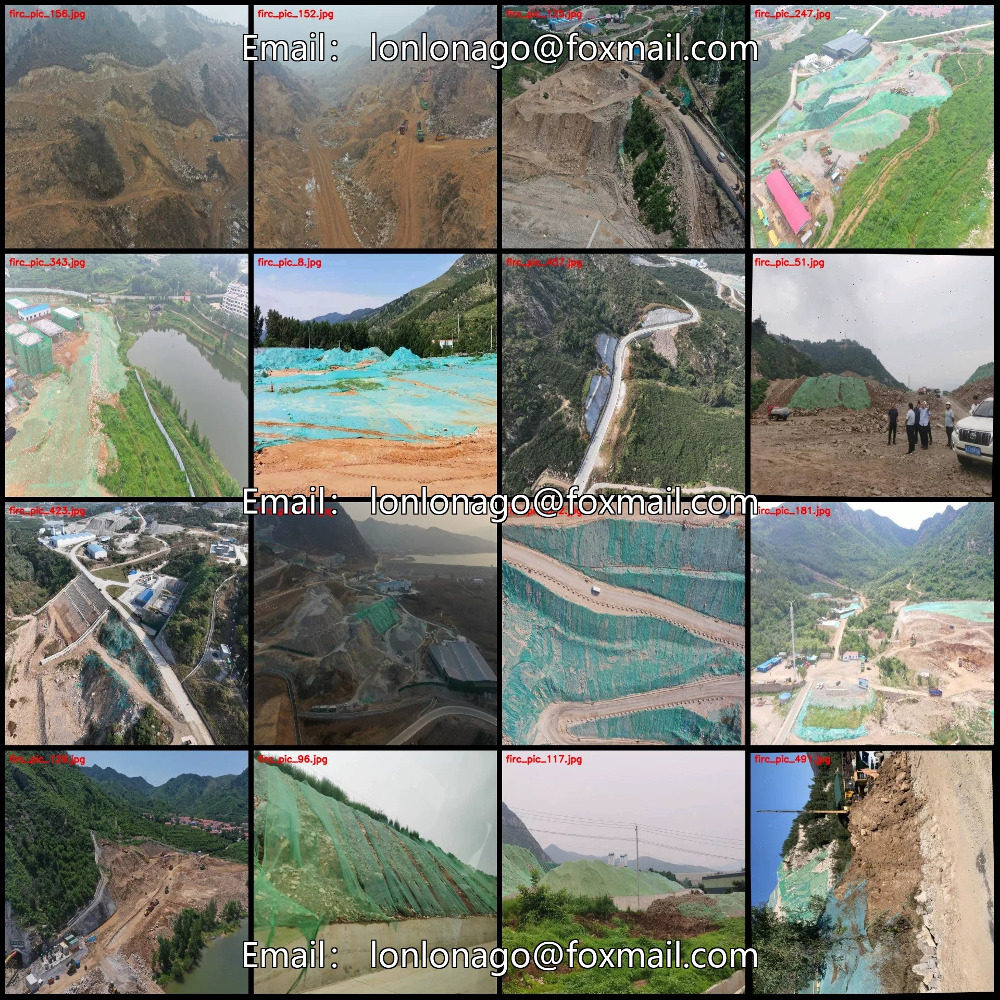
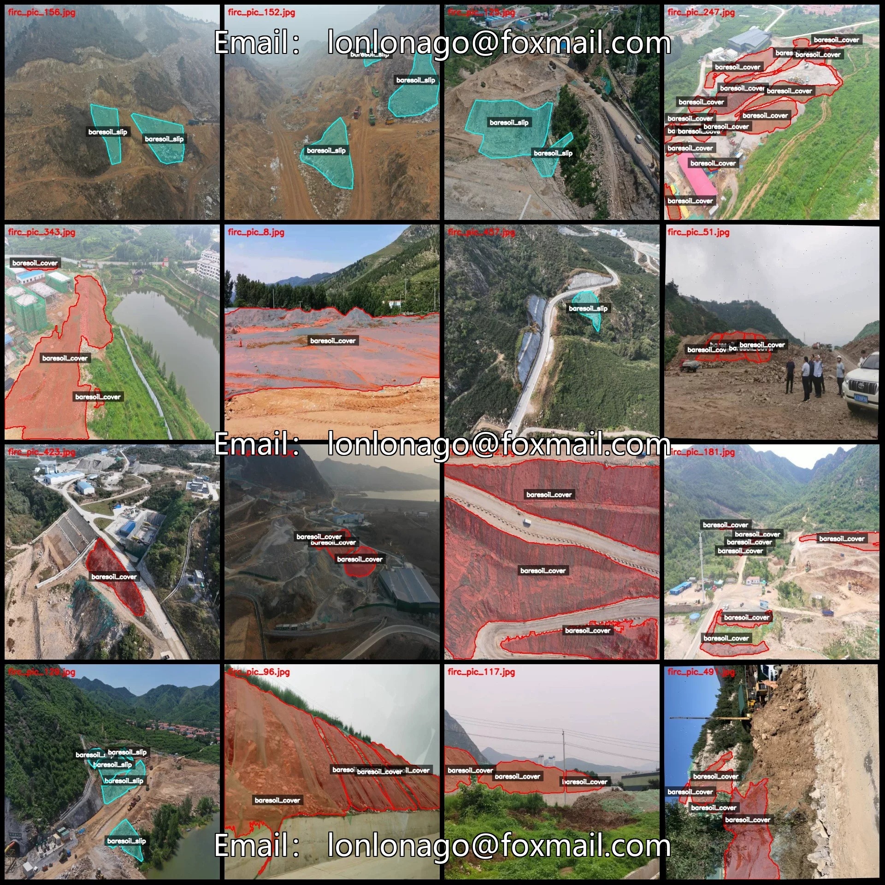
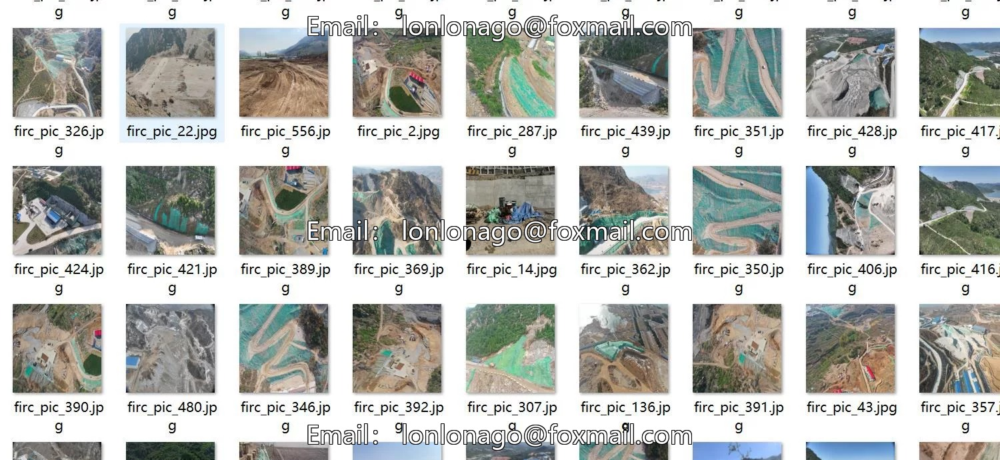
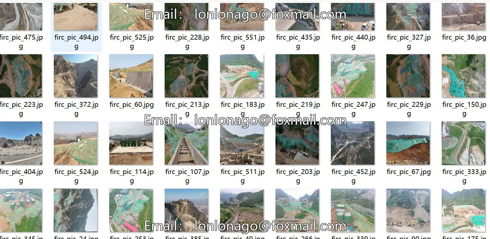
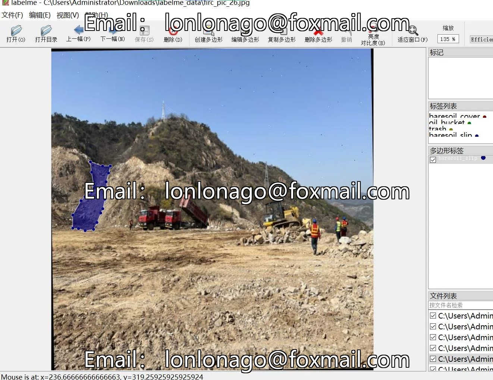

# UAV-view naked soil coverage recognition segmentation dataset labelme format 592 images 4

## Body

592 drone-view bare soil coverage recognition segmentation dataset in labelme format, 4 categories
Please note: Due to the dataset's replicability, after purchase, please confirm compliance before purchasing.
Dataset format: labelme format (without mask files, only containing jpg images and corresponding json files)
Number of images (number of jpg files): 592
Number of annotations (number of json files): 592
Number of annotation categories: 4
Annotation category names: ["baresoil_cover", "baresoil_slip", "oil_bucket", "trash"]
The number of bounding boxes for each category

Baresoil_cover (bare soil coverage) count = 1748
Baresoil_slip (bare soil slip) count = 680
Oil_bucket (oil bucket) count = 21
Trash (trash) count = 79
Total frames: 2528
Using labelme tool: labelme=5.5.0
Image resolution: 640x640
Annotation rules: Polygons are drawn around the categories.
Important note: The dataset can be opened and edited using labelme, but JSON datasets need to be converted into mask or yolo format or coco format for semantic segmentation or instance segmentation.

Special : This dataset does not guarantee the accuracy of the trained models or weight files.

## Images

## Payment

Here is a pay link on Stripe ( https://buy.stripe.com/3cs8yP7sY87d0vu9AB ). Please contact me lonlonago@foxmail.com after funding $89, and I will send you a complete data files , thank you!

